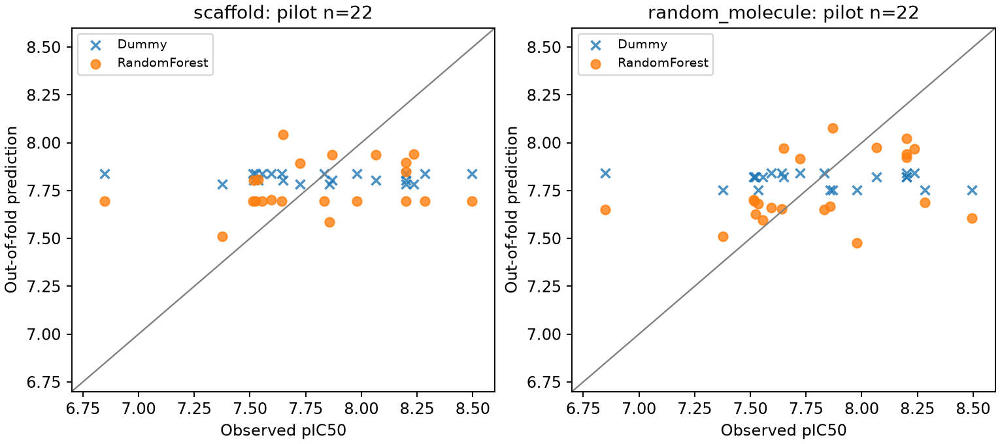

# 209건 원문 검토와 Dummy·Random Forest 교육 실험

2026-10-20. **209건을 확정 학습 데이터로 사용하지 않았습니다.** 원문·수치·표적 연결을 검토했지만 WT·종 유래·전체 부속 표·상세 조건을 확정하지 못했습니다. 대신 원문 수치 22건과 주요 조건을 이미 확인한 단일 assay에서 교육·탐색용 모델 실행을 완료했습니다. 일반 EGFR benchmark 또는 임상 성능 결과가 아닙니다.

## 209건 검토 결과

대상은 Apsel 등, *Targeted polypharmacology: discovery of dual inhibitors of tyrosine and phosphoinositide kinases*, Nature Chemical Biology 2008;4:691–699, DOI [10.1038/nchembio.117](https://doi.org/10.1038/nchembio.117), PMID18849971, CHEMBL1243977입니다. [공개 본문](https://pmc.ncbi.nlm.nih.gov/articles/PMC2880455/), [저자 공개 PDF](https://shokatlab.ucsf.edu/pdfs/18849971.pdf).

| 검토 항목 | 결과 |
|---|---|
| ChEMBL 원 관측 | 209건 |
| 정확한 양수 nM 기록 | 167건. 과학적 적격성이 확정된 167건은 아님 |
| 부등호·표준값 결측 등 | 42건 |
| 본문 Figure 2a의 EGFR 행 | 화합물 record·activity ID까지 8건 연결, 관계 기호·단위·수치 일치 |
| 본문 방법 | ATP 10 µM, 방사성 인산 전달·phosphorimaging, 시험 농도 0.001–50 µM |
| 추가 수치 확인 필요 | 정확값으로 저장된 100 µM 28건, 본문 최대 농도보다 높은 정확값 총30건 |
| WT·단백질 종 유래·상세 조건 | 미확정. DB confidence8·homolog(H) 연결을 human WT로 덮어쓰지 않음 |
| 최종 결정 | 209건 전체 보류, 학습 승인0건 |

Figure 2a는 µM 표입니다. 예를 들어 PP20=0.17 µM는 170 nM, PP121=0.26 µM는 260 nM입니다. PIK-294는 **>50 µM**이며 정확값 50 µM가 아닙니다. figure 8건이 맞는다고 SI 전체나 단백질 유래까지 검증된 것은 아닙니다.

100 µM 반복값은 inactive sentinel·농도 상한·별도 조건 등 여러 가능성이 있으므로 원 표 확인 전에는 `>`로 바꾸거나 오류로 단정하지 않습니다. PMC 다운로드는 PDF 대신 다운로드 준비용 JavaScript challenge, 출판사·미러는 challenge/403/404 응답을 반환했습니다. 이를 실제 SI 확보로 기록하지 않았습니다. 본문 Figure2a(page693)와 Methods(page698)는 PDF 렌더링으로 확인했습니다.

재현 출력은 `data/interim/apsel_review_20261020/measurement_review.csv`, `figure2_crosscheck.csv`, `manifest.json`입니다. 원 자료는 변경하지 않았습니다.

## 실제 모델 실행 범위

사용 데이터는 CHEMBL4258549 / DOI10.1039/C7MD00571G의 원문 표 22건·22구조·12 scaffold입니다. ATP5 µM, 37°C·60분, ELISA 조건이 확인된 같은 assay입니다. human WT는 ChEMBL 설명·표적 연결에 근거하며, 정확 구성체·효소 농도·반복 오차 정의는 여전히 미확인입니다. 기존 `training_ready=false`와 최종 코호트 미확정 상태를 유지합니다. [원문](https://pmc.ncbi.nlm.nih.gov/articles/PMC6083791/)

작은 표본을 70/15/15로 쪼개 몇 개의 시험 분자에 의존하는 결과를 만들지 않도록, **이 교육 실험에 한해** 3-fold scaffold 교차검증을 사전에 고정했습니다. 본 프로젝트의 향후 최종 시험 설계와 구별합니다.

- 입력: SMILES에서 Morgan bit fingerprint(radius2, 2048bit, 입체 정보 포함)만 계산. 문헌·화합물 번호·정답은 특징에 넣지 않음.
- Dummy: 각 학습 fold의 pIC50 평균을 평가 fold에 예측.
- RF: 300개 tree, 최소 leaf2, max_features1.0, seed42/123/2026. 튜닝·최적 seed 선택 없음.
- 주 평가: scaffold 분리. 학습/평가11/11, 16/6, 17/5건; 골격 중복0.
- 보조 평가: 같은 22개 분자의 random 3-fold. 새로운 골격 평가로 해석하지 않음.
- 각 분자는 분할별·seed별·모델별로 평가 예측을 한 번만 가짐. 전체 OOF 22건의 오차를 계산.
- 비교: 같은 평가 분자의 RF−Dummy MAE 차이. 고정 OOF 예측에 대해 12개 scaffold를 2,000회 재표집한 탐색적 구간.

[Dummy 공식 설명](https://scikit-learn.org/stable/modules/generated/sklearn.dummy.DummyRegressor.html), [RF 공식 설명](https://scikit-learn.org/stable/modules/generated/sklearn.ensemble.RandomForestRegressor.html), [GroupKFold](https://scikit-learn.org/stable/modules/generated/sklearn.model_selection.GroupKFold.html). 파라미터·재표집 설정은 프로젝트 선택이며 EGFR 합격선이 아닙니다.

## 결과와 읽는 방법

아래는 사전에 정한 seed42 결과입니다. 모든 seed의 전체 결과는 [metrics.csv](baseline_pilot_20261020_v2/metrics.csv)에 있습니다.

| 평가 | 모델 | MAE | RMSE |
|---|---|---:|---:|
| scaffold | Dummy | 0.3096 | 0.3759 |
| scaffold | RF | 0.2950 | 0.3640 |
| random | Dummy | 0.3172 | 0.3817 |
| random | RF | 0.2647 | 0.3485 |

주 평가의 RF−Dummy MAE 차이는 **−0.0146**, 탐색적 95% 구간은 **[−0.0819, +0.0506]**입니다. 음수면 RF 오차가 작지만 구간에0이 포함됩니다. 세 seed의 scaffold RF MAE는0.2925–0.3001이었고 차이 구간은 모두0을 포함합니다. **현재 자료로 RF 우위를 확정하지 않습니다.**

이 구간은 고정 OOF 예측에 조건부입니다. fold마다 학습 자료가 겹치고 모든 관측이 같은 문헌에서 왔으므로 학습 절차 전체·미래 문헌의 불확실성을 포괄하지 않습니다. 가장 큰 골격에11/22건이 몰려 있고 고유 라벨 범위도 약1.647 log뿐입니다. 개별 큰 오차를 반드시 함께 읽습니다. 예: 화합물2의 절대 오차 약0.847, 화합물25는 약0.801입니다. 평균 MAE가 작아도 모든 예측의 오차가 작다는 뜻은 아닙니다.

각 fold의 Dummy 예측은 상수여서 Spearman을 비워 둡니다. 합친 OOF Dummy 예측은 서로 다른 학습 평균 때문에 달라질 수 있으며, 이때의 상관을 구조 학습 능력이라고 해석하지 않습니다.

선에 가까울수록 관측과 예측이 비슷합니다. RF도 평균 부근으로 모이며 강한/약한 화합물에서 오차가 큽니다. 이 그림은 환자 치료 결과가 아닙니다.

## 실행 환경·파일

- `.venv-ml`: 기존 P0 `.venv`와 분리한 Python3.12 환경. scikit-learn1.9.1, SciPy1.18.1, NumPy2.5.4, RDKit2026.9.1.
- [버전 스냅샷](../requirements/ml-py312-macos-arm64.freeze.txt)은 현재 Mac 설치 버전이며 해시가 있는 wheel lock이나 다른 플랫폼 검증으로 표현하지 않습니다.
- [실험 설정](../configs/baseline_pilot.json)을 결과 확인 전에 고정했고, 입력 해시·검토 보류 목록을 검사합니다.
- `artifacts/baseline_pilot_20261020_v2/`: 특징 행렬·설정 스냅샷·fold별 저장 모델. 209건 혼입 없음.
- [최종 실행 매니페스트](baseline_pilot_20261020_v2/manifest.json): 입력·코드·모델·보고 파일 해시, 환경·seed·범위.
- [실습 안내](../docs/11_baseline_practice_ko.md): 재실행·문제·해설과 한국어 자가 점검.

검증: 전체 테스트 **43개 통과**, `pip check` 통과. [독립 산출물 검사](baseline_pilot_validation.json)에서 저장 모델36개를 다시 불러 OOF 예측264행과 대조하고, 라벨·MAE·RMSE를 재계산했습니다. 주 분할의 scaffold 중복0, Dummy의 학습 fold 평균 사용, 209건 혼입0, 기존 `training_ready=false` 보존, 입력·모델·출력 해시 일치를 확인했습니다.

P0의 최종 학습 코호트는 미확정이며 P1은 교육 파일럿 실행으로 진행 중입니다. 본 프로젝트의 M1 완료 또는 D-MPNN으로 진행할 충분한 데이터 확보를 선언하지 않습니다.
